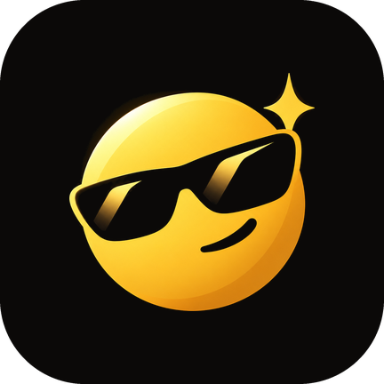

<div align="center">



# Cooley

**An ad-free YouTube Music and YouTube app for Android, with a Music side and a Video side.**
Built on top of [SimpMusic](https://github.com/maxrave-dev/SimpMusic) by [maxrave-dev](https://github.com/maxrave-dev),
with a video player ported from [LibreTube](https://github.com/libre-tube/LibreTube).

<a href="https://github.com/doomanity/Reliefy/releases/latest"></a>
<a href="LICENSE"></a>

</div>

## What Cooley adds

Everything SimpMusic does (ad-free playback, background play, lyrics, equalizer, downloads, and a lot more), plus:

- **Video side**: tap the app name on Home and pick Video for a YouTube style video app without ads. Its player
  is ported from LibreTube (background play, picture in picture, SponsorBlock, dislike counts, quality and speed)

- **Customize page** (Settings → User interface → Customize look), with a live preview:
  - **Themes**: one-tap presets (Cooley, SimpMusic Classic, Midnight, Sakura, Forest, Sunset, Neon, Mono)
  - **Accent color**: quick swatches, or your wallpaper colors on Android 12+
  - **Color style**: Balanced, Vibrant, Expressive, Muted, True color, Rainbow, Fruit salad, Monochrome
  - **Corner roundness**: Sharp, Soft, Round, Extra round. Applies across the whole app
  - **Animation feel**: Smooth, Snappy, Bouncy or Reduced, for screen transitions and Material motion
  - **Dark background**: pure black (OLED) or soft dark
  - **Song transitions**: crossfade on/off and length, right next to the looks
- **Crossfade on by default**, so songs fade into each other out of the box
- A calm mint default color

## Download

Grab the latest APK from [Releases](https://github.com/doomanity/Reliefy/releases/latest):

- Most phones: `Cooley-x.y.z-arm64-v8a.apk`
- Not sure? `Cooley-x.y.z-universal.apk` works everywhere (bigger file)

Every push to `main` builds a new signed APK automatically with GitHub Actions
([workflow](.github/workflows/build-apk.yml)). No Android Studio needed.

## Building it yourself

```bash
./gradlew :androidApp:assembleRelease
```

This is the FOSS build (`isFullBuild=false` in `gradle.properties`): no Sentry crash reporting, no Google Cast.

## Credits

Cooley (formerly Reliefy) is a fork. Nearly all of the app is the work of **[maxrave-dev](https://github.com/maxrave-dev)** and the
**[SimpMusic contributors](https://github.com/maxrave-dev/SimpMusic/graphs/contributors)**. If you like it, please
star and support [the original project](https://github.com/maxrave-dev/SimpMusic).

- Upstream source: [maxrave-dev/SimpMusic](https://github.com/maxrave-dev/SimpMusic) and [maxrave-dev/core](https://github.com/maxrave-dev/core) (vendored in `core/`)
- The video player, its stream loading (NewPipe Extractor with PoToken and SABR), SponsorBlock and dislike support
  are ported from [LibreTube](https://github.com/libre-tube/LibreTube) by the
  [LibreTube contributors](https://github.com/libre-tube/LibreTube/graphs/contributors), GPL-3.0
- The original README is kept as [README.SimpMusic.md](README.SimpMusic.md)
- SimpMusic's own credits (InnerTune, SmartTube, SponsorBlock, LRCLIB, and others) are listed there and in the app's About screen

Cooley is not affiliated with SimpMusic, maxrave-dev, LibreTube, YouTube or Google.

## License

GPL-3.0, same as SimpMusic and LibreTube. See [LICENSE](LICENSE). Changes made in this fork are also GPL-3.0.
